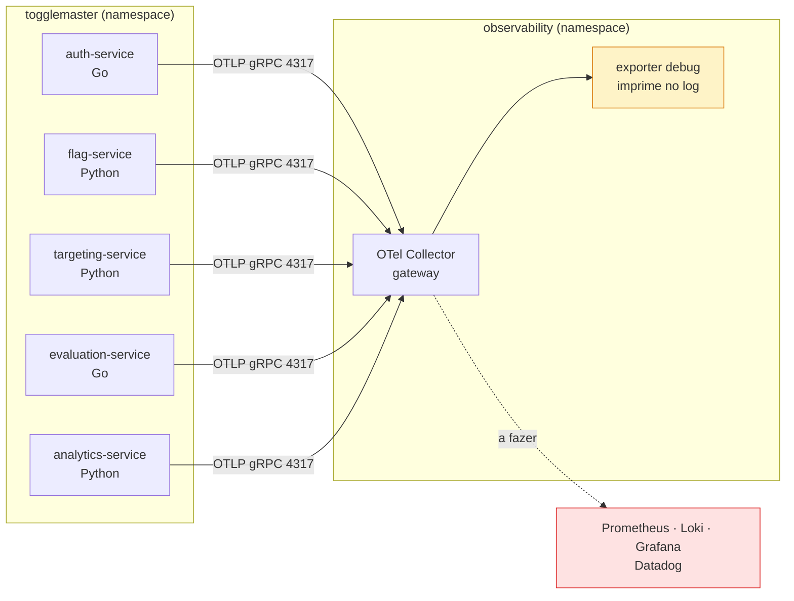

# Guia de observabilidade — como está e como continuar

Guia para quem vai dar sequência à Fase 4. Diferente dos documentos em [`desafios/`](desafios/), que são o registro histórico de cada problema enfrentado, este aqui é **mapa, convenções e próximos passos**.

Leia as seções 1 a 3 antes de mexer em qualquer coisa. A seção 6 é a que mais economiza tempo.

---

## 1. Estado atual

Os cinco microsserviços estão instrumentados com OpenTelemetry e enviando os três sinais para um Collector no cluster. O Collector hoje só imprime o que recebe — não há backend ainda.



| Frente | Situação |
|---|---|
| Instrumentação dos 5 serviços | **pronta** — traces, métricas e logs |
| OTel Collector no cluster | **pronto** — gateway, exporter `debug` |
| Propagação síncrona (HTTP) | **pronta** — atravessa Python e Go |
| Propagação assíncrona (SQS) | **pronta** — span link entre produtor e consumidor |
| Prometheus, Loki, Grafana | a fazer — rodada 2 |
| Dashboard customizado | a fazer — rodada 2 |
| Datadog (APM) | a fazer |
| Alertas, PagerDuty/OpsGenie, ChatOps | a fazer — rodada 3 |
| Self-healing | a fazer — rodada 3 |

**O que já dá para ver hoje:** uma requisição a `/evaluate` gera um trace com quatro serviços, e o evento publicado na fila liga ao consumidor por span link. Tudo isso está no log do Collector — falta só o backend para visualizar.

---

## 2. O mapa — onde mexer para mudar o quê

### Neste repositório

| Caminho | O quê |
|---|---|
| `platform/observability/otel-collector/` | Chart do Collector: `Chart.yaml` com a dependência, `values.yaml` com a configuração |
| `platform/README.md` | **A convenção para acrescentar um componente novo.** Leia antes de criar Prometheus ou Loki |
| `applications/otel-collector.yaml` | A Application do Argo CD |
| `charts/base/templates/deployment.yaml` | O bloco `otel` que injeta as variáveis nos cinco serviços |
| `charts/base/values.yaml` | Defaults de `otel` — desligado por padrão |
| `apps/<serviço>/values-prod.yaml` | `otel.enabled: true` e as variáveis específicas de cada um |

### Nos outros repositórios

| Repositório | O quê |
|---|---|
| `auth-service`, `evaluation-service` | `otel.go` — SDK em Go, escrito à mão |
| `flag-service`, `targeting-service`, `analytics-service` | `requirements.txt` e `Dockerfile` — instrumentação zero-code |
| `analytics-service/app.py` | A extração do `traceparent` da mensagem SQS |
| `evaluation-service/sqs.go` | A injeção do `traceparent` na mensagem |
| `togglemaster-platform-legacy` | Ambiente local de testes, com Collector em container |
| `togglemaster-iac` | Nada de observabilidade por enquanto. Só entra se Prometheus/Loki precisarem de bucket S3 ou IRSA |

### A configuração que os serviços recebem

Vem do chart base, sem cada serviço repetir:

```yaml
otel:
  enabled: false                 # ligado por serviço, em apps/<serviço>/values-prod.yaml
  namespace: togglemaster        # vira service.namespace
  environment: prod              # vira deployment.environment.name
  endpoint: http://otel-collector.observability.svc.cluster.local:4317
  protocol: grpc
  extraEnv: []                   # variáveis específicas, ex. as de Python
```

O `service.name` sai do nome do release e o `service.version` da tag da imagem. O `service.instance.id` vem do nome do pod, pela Downward API.

---

## 3. Convenções — as regras que já estão valendo

Seguir estas evita contradizer o que existe. Cada uma tem um porquê documentado em [`desafios/`](desafios/).

**Um chart e uma Application por componente.** Não um chart de observabilidade com várias dependências. Cada componente tem saúde, sync e rollback próprios no Argo. Detalhes em [`platform/README.md`](../platform/README.md).

**Chart de terceiros entra como dependência de um chart nosso**, nunca como Application apontando direto para o repositório Helm. O `Chart.lock` fixa a versão — mesma ideia dos módulos Terraform fixados por tag.

**Manifestos nossos ficam no `templates/` do componente de que dependem.** O dashboard do Grafana e as `PrometheusRule` vão no wrapper do `kube-prometheus-stack`: nascem e morrem com ele, na ordem certa.

**Resource attributes seguem a convenção atual.** Atenção: `deployment.environment` está **depreciado** desde o semconv 1.27 — o nome correto é `deployment.environment.name`. É também o que o Datadog lê para montar a tag `env`.

**Nome de span é a rota, não a URL.** `GET /flags/<string:name>`, não `GET /flags/minha-flag`. Sem isso, cada valor vira um "endpoint" diferente no APM e não há agregação.

**Amostragem está em 100%.** É desvio consciente da recomendação para produção, porque no volume da demonstração é o que garante que o trace procurado exista.

**Atributos `k8s.*` vêm do Collector**, pelo processor `k8sattributes`. A aplicação não os conhece.

---

## 4. Como continuar — rodada 2

### Acrescentar Prometheus, Loki ou Grafana

O caminho está pronto. Para cada um:

```bash
mkdir -p platform/observability/<componente>
# Chart.yaml com a dependência, no modelo do otel-collector
# values.yaml com a configuração do subchart
cd platform/observability/<componente>
helm dependency update        # gera o Chart.lock — versione ele, não o .tgz
```

Depois, `applications/<componente>.yaml`, copiando o do `otel-collector` e trocando `path` e `name`.

**Sugestão de componentes:** `kube-prometheus-stack` traz Prometheus, Alertmanager e Grafana num chart só; o Loki vai separado.

### Ligar os destinos no Collector

É o passo que torna tudo visível. Em `platform/observability/otel-collector/values.yaml`, acrescentar os exporters e incluí-los nas pipelines:

```yaml
exporters:
  debug:
    verbosity: detailed
  prometheus:              # métricas
    endpoint: 0.0.0.0:8889
  otlphttp/loki:           # logs
    endpoint: http://loki.observability.svc.cluster.local:3100/otlp

service:
  pipelines:
    metrics:
      exporters: [debug, prometheus]
    logs:
      exporters: [debug, otlphttp/loki]
```

**Atenção:** o exporter `loki` está **depreciado** desde julho de 2024. O caminho atual é `otlphttp` apontando para o endpoint OTLP do Loki, suportado nativamente a partir do Loki 3.

Acrescentar um destino **não exige tocar em nenhum serviço** — é só mais um exporter na lista. Esse é o ponto do Collector existir.

### Armazenamento — decisão pendente

`togglemaster-iac/infra/main.tf` tem `enable_ebs_csi_driver = false`. **Sem esse driver, nenhum PersistentVolumeClaim é atendido**, e tanto o `kube-prometheus-stack` quanto o Loki pedem PVC por padrão.

Duas saídas:
- Ligar o driver no Terraform, e ter disco de verdade com custo de EBS
- Rodar efêmero, com `emptyDir` e retenção curta de 24 a 48 horas

Para demonstração, a segunda basta.

### Capacidade do nó

O node group fixo é **um t3.large**, com `1930m` alocáveis e cerca de `1550m` já reservados. O Collector coube em 100m. Prometheus, Loki e Grafana **não cabem** no que sobra — o Karpenter vai provisionar um nó novo, o que funciona mas custa.

Definir `resources.requests` em tudo: sem isso o Karpenter dimensiona mal.

---

## 5. Como continuar — rodada 3

### Datadog

O exporter e o connector **só existem na imagem `contrib`**, que já é a usada. Entra como mais um exporter, mais o `datadog/connector` no pipeline de traces:

```yaml
connectors:
  datadog/connector:
exporters:
  datadog/exporter:
    api:
      site: datadoghq.com
      key: ${env:DD_API_KEY}
service:
  pipelines:
    traces:
      exporters: [datadog/connector, datadog/exporter]
    metrics:
      receivers: [otlp, datadog/connector]
```

**Sem o connector, o Datadog não calcula as métricas de APM por serviço** — requisições por segundo, taxa de erro e latência — que alimentam os painéis e os monitores.

A `DD_API_KEY` deve vir do Secrets Manager via External Secrets, no mesmo padrão dos segredos dos serviços. **Não usar `DD_ENV`, `DD_SERVICE` nem `DD_VERSION`** junto com os resource attributes: configurar o mesmo conceito por dois caminhos produz valores duplicados.

### Alertas e PrometheusRule

Vão em `templates/` do wrapper do `kube-prometheus-stack`, porque dependem da CRD que ele instala.

Um ponto de arquitetura que vale discutir antes: **a stack de observabilidade cai junto com o que ela observa**. Se o alerta que aciona o self-healing depender de um Alertmanager rodando no mesmo nó que está com problema, ele pode não disparar. Por isso a recomendação registrada é usar o **Datadog, que é externo, para o caminho do alerta**, e o Grafana para investigação.

### Self-healing

Duas opções, com trade-off real:
- **GitHub Action por `repository_dispatch`** — aproveita a esteira que já existe, mas precisa de credencial para alcançar o cluster
- **Lambda na VPC** — evita expor credencial, mas é um componente novo

Decisão em aberto.

---

## 6. Armadilhas conhecidas

Cada uma destas custou tempo. Todas produzem o mesmo sintoma: **nada quebra, e o dado simplesmente não aparece**.

### `kubectl logs -l` esconde o resultado

```bash
# ERRADO: com seletor de label, o default é --tail=10
kubectl logs -n observability -l app.kubernetes.io/name=opentelemetry-collector --since=10m

# CERTO
kubectl logs -n observability -l app.kubernetes.io/name=opentelemetry-collector --tail=-1 --since=10m
```

Sem o `--tail=-1`, você vê dez linhas e conclui que nada chegou. Esse erro foi cometido duas vezes durante a implementação.

### `cursor_factory` explícito mata o span de banco (Python)

O instrumentador do psycopg2 substitui o `cursor_factory` **da conexão**. Passar a fábrica na chamada sobrescreve a instrumentada:

```python
cur = conn.cursor(cursor_factory=RealDictCursor)   # span não nasce
cur = conn.cursor()                                 # span nasce
```

A fábrica vai na criação do pool. Detalhes em `flag-service/docs/desafios/05-instrumentacao-otel.md`.

### O SQS não devolve atributos a menos que você peça

```python
sqs_client.receive_message(..., MessageAttributeNames=['All'])
```

Sem isso, o produtor injeta o `traceparent` corretamente e o consumidor nunca o recebe. A propagação parece quebrada no lado errado.

### A parede do Go 1.26

OTel `1.47`, `otelhttp 0.72`, `otelslog 0.21` e `redisotel v9.23` **exigem Go 1.26**. O projeto está em 1.25, e a linha imediatamente anterior de cada um funciona:

| Pacote | Versão em uso |
|---|---|
| `go.opentelemetry.io/otel` e SDK | `v1.46.0` |
| `otelhttp` | `v0.71.0` |
| `otelslog` | `v0.20.0` |
| `otlploggrpc`, `sdk/log` | `v0.22.0` |
| `redisotel/v9` | `v9.22.0` |

A API e o SDK de **logs** saltaram de `v0.22.0` direto para `v1.47.0` ao se estabilizarem — não existe `v1.46.0` deles.

### `k8s_attributes` com underscore não é erro

O chart gera o processor como `k8s_attributes`, e a documentação o chama de `k8sattributes`. **Os dois nomes são válidos** — são alias. Verificado com `otelcol-contrib validate`.

### Lote de mensagens usa link, não parent-child

Um poll do SQS traz até dez mensagens de traces diferentes, e **um span tem um pai só**. Por isso o consumidor cria um span com `Link` para o contexto do produtor, como manda a convenção de mensageria.

---

## 7. Como validar

### Ambiente local

O `togglemaster-platform-legacy` sobe os cinco serviços e um Collector com exporter `debug`. Ciclo de segundos, sem depender do cluster:

```bash
cd togglemaster-platform-legacy
docker compose up -d --build <serviço> otel-collector
docker compose logs -f otel-collector
```

**Não é possível testar a cadeia do SQS localmente** — exige fila e credenciais da AWS. Essa parte só fecha no cluster.

### No cluster

```bash
# A Application está saudável?
kubectl get applications -n argocd

# O Collector está recebendo?
kubectl logs -n observability -l app.kubernetes.io/name=opentelemetry-collector --tail=-1 --since=5m

# Algum serviço falhando a exportar?
kubectl logs -n togglemaster -l app=<serviço> --tail=-1 --since=5m | grep -i "connection refused"
```

O terceiro é o teste mais direto: **se não há `Connection refused`, o caminho está funcionando**.

### Antes de abrir PR

| Verificação | Comando |
|---|---|
| Python | `ruff check .` com a versão `0.17.0`, a mesma da esteira |
| Go | `go build ./...`, `go vet ./...` e `golangci-lint` `v2.14.0` |
| Dependências | `trivy fs .` — o gate da esteira reprova em CRITICAL |

As versões das ferramentas estão fixadas no `reusable-workflows` desde a `v2.2.5`. Rodar local com versão diferente dá resultado diferente do CI.

---

## 8. Onde aprofundar

| Documento | Assunto |
|---|---|
| [`desafios/08-otel-collector-e-charts-de-terceiros.md`](desafios/08-otel-collector-e-charts-de-terceiros.md) | Por que chart wrapper, e a estrutura do `platform/` |
| `flag-service/docs/desafios/05-instrumentacao-otel.md` | Auto-instrumentação em Python e seus pontos cegos |
| `auth-service/docs/desafios/05-instrumentacao-otel.md` | SDK em Go escrito à mão, e por que o propagador é crítico |
| `evaluation-service/docs/desafios/05-instrumentacao-otel.md` | `context` em cinco camadas, Redis v9 e injeção no SQS |
| `analytics-service/docs/desafios/05-instrumentacao-otel.md` | Consumo de fila, span link e a convenção de mensageria |
