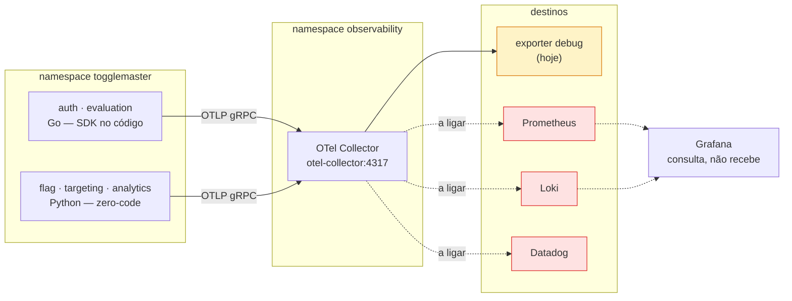

# Guia de observabilidade — como o dado flui e como consumi-lo

Guia para quem vai dar sequência à Fase 4. A **Parte 1** explica os três sinais e o formato real em que eles chegam. A **Parte 2** é a receita para plugar cada backend. Da **Parte 3** em diante: mapa dos arquivos, convenções em vigor e armadilhas conhecidas.

Todos os exemplos são **saída real do nosso cluster**, capturada do Collector. Você pode rodar o mesmo comando e comparar:

```bash
kubectl logs -n observability -l app.kubernetes.io/name=opentelemetry-collector --tail=-1 --since=5m
```

---

## O caminho, em uma figura



Um detalhe que confunde muita gente: **o Grafana não recebe telemetria**. Ele consulta o Prometheus e o Loki. Não existe "exportar para o Grafana".

---

# Parte 1 — Os três sinais

Os três saem da aplicação pela **mesma porta** (OTLP gRPC 4317) e seguem **pipelines independentes** dentro do Collector. Isso é o que permite mandar trace para um lugar e log para outro sem que uma decisão interfira na outra.

## O Resource — o que vem em todos os sinais

Antes dos sinais, o bloco que acompanha todos eles. Saída real do `flag-service`:

```
Resource attributes:
     -> telemetry.sdk.language: Str(python)
     -> telemetry.sdk.name: Str(opentelemetry)
     -> telemetry.sdk.version: Str(1.45.1)
     -> service.instance.id: Str(45c592bc-2d15-4e91-bcf1-691ec30c8af5)
     -> service.namespace: Str(togglemaster)
     -> service.version: Str(42a8e4ef3f4a5ed77c39de9f3ffb9beaa6482757)
     -> deployment.environment.name: Str(prod)
     -> service.name: Str(flag-service)
     -> telemetry.auto.version: Str(0.66b1)
     -> k8s.namespace.name: Str(togglemaster)
     -> k8s.replicaset.name: Str(flag-service-55958f5566)
     -> k8s.pod.name: Str(flag-service-55958f5566-xzbgb)
     -> k8s.pod.start_time: Str(2026-10-10T17:17:39Z)
     -> k8s.pod.uid: Str(ff276949-e85f-45a3-a24c-66bdef6715ab)
     -> k8s.deployment.name: Str(flag-service)
```

Lendo por origem:

| Atributos | De onde vêm |
|---|---|
| `service.name`, `service.namespace`, `service.version`, `deployment.environment.name` | Variáveis `OTEL_*` injetadas pelo chart base |
| `telemetry.sdk.*`, `telemetry.auto.version` | O próprio SDK |
| `k8s.*` | **O Collector**, pelo processor `k8sattributes` — a aplicação não os conhece |

O `service.version` é o SHA do commit que gerou a imagem. É o que liga qualquer trace ao código exato que o produziu.

> **Atenção:** o `service.instance.id` acima é um UUID, e deveria ser o nome do pod. Nos serviços em Go ele sai correto. Ver a armadilha na seção 6.

## Traces

**Quem produz:** o SDK, automaticamente, a cada requisição HTTP, query de banco, comando Redis ou chamada à AWS.

**Como chega:** um `ResourceSpans` por serviço, contendo `ScopeSpans` por biblioteca de instrumentação, cada um com seus spans.

Span real do `flag-service` atendendo um `GET /flags`:

```
ScopeSpans SchemaURL: https://opentelemetry.io/schemas/1.11.0
InstrumentationScope opentelemetry.instrumentation.flask 0.66b1
Span #0
    Trace ID       : 961a51c394b4a264a07b49e972defdf6
    Parent ID      :
    ID             : ad5e8c2ee29c3df3
    Name           : GET /flags
    Kind           : Server
    Start time     : 2026-10-10 18:53:15.602990197 +0000 UTC
    End time       : 2026-10-10 18:53:15.610731132 +0000 UTC
    Status code    : Unset
Attributes:
     -> http.method: Str(GET)
     -> http.route: Str(/flags)
     -> http.status_code: Int(200)
     -> net.peer.ip: Str(10.0.2.251)
```

Os campos que importam:

| Campo | Para que serve |
|---|---|
| `Trace ID` | O fio que costura a requisição inteira, em todos os serviços |
| `Parent ID` | Monta a árvore. Vazio = span raiz |
| `ID` | Identidade deste span; é o `Parent ID` dos filhos |
| `Name` | **A rota, não a URL** — é o que permite agregar por endpoint |
| `Kind` | `Server` atende, `Client` chama, `Producer`/`Consumer` para fila |
| `Status code` | `Unset` é normal; `Error` é o que pinta vermelho no APM |
| `End - Start` | A duração, que vira latência nos gráficos |

No mesmo trace, o span da consulta ao banco:

```
InstrumentationScope opentelemetry.instrumentation.psycopg2 0.66b1
    Name           : SELECT
    Kind           : Client
    Parent ID      : ad5e8c2ee29c3df3        ← filho do span acima
Attributes:
     -> db.system: Str(postgresql)
     -> db.name: Str(flags_db)
     -> db.statement: Str(SELECT * FROM flags ORDER BY name)
     -> net.peer.name: Str(rds-togglemaster-flags.cgp2umqeeb5r.us-east-1.rds.amazonaws.com)
```

Repare que o `db.statement` mantém o `%s` quando há parâmetro: os valores **não** são interpolados. Isso evita vazar dado de usuário na telemetria e mantém a query agregável.

## Logs

**Quem produz:** a aplicação, pelo logger normal. Em Python pela ponte de logging; em Go pelo `slog` com o handler do OTel.

**Como chega:** registro OTLP com o contexto de trace em **campos próprios**, não dentro do texto.

Log real do `auth-service`:

```
LogRecord #0
Timestamp: 2026-10-10 18:53:15.284379374 +0000 UTC
SeverityText: INFO
SeverityNumber: Info(9)
Body: Str(Nova chave criada com sucesso)
Attributes:
     -> id: Int(5)
     -> nome: Str(doc-samples)
Trace ID: bb4bb131547d06597ba1a7a9bb5ef30d
Span ID: d4624932eec50d9a
```

Duas coisas a notar:

**`Trace ID` e `Span ID` são campos do registro.** Não é preciso extrair do texto com regex. É isso que permite, no backend, clicar num trace lento e ver exatamente os logs daquela execução.

**Os valores são atributos tipados**, não interpolados na mensagem. `id: Int(5)` em vez de `"chave 5 criada"`. Isso torna o log consultável por campo.

## Métricas

**Quem produz:** as bibliotecas de instrumentação, sem configuração extra.

**Como chega:** um descritor mais pontos de dado.

Métrica real:

```
Metric #0
Descriptor:
     -> Name: http.server.active_requests
     -> Description: Measures the number of concurrent HTTP requests that are currently in-flight.
     -> Unit: requests
     -> DataType: Sum
     -> IsMonotonic: false
     -> AggregationTemporality: Cumulative
NumberDataPoints #0
Data point attributes:
     -> http.method: Str(GET)
```

O que vem hoje, de graça: `http.server.active_requests`, `http.server.duration`, `http.server.request.body.size` e `http.server.response.body.size`.

O que **não** vem: métricas de runtime (heap, goroutines, GC) e métricas de negócio, como taxa de acerto de cache. As duas exigem código.

---

# Parte 2 — Receita por backend

O princípio: **acrescentar um destino é acrescentar um exporter**. Nenhum serviço é tocado, nenhuma imagem é reconstruída. Tudo acontece em `platform/observability/otel-collector/values.yaml`.

A forma geral:

```yaml
exporters:
  <nome>: { ... }              # 1. declara o destino

service:
  pipelines:
    <sinal>:
      exporters: [debug, <nome>]   # 2. inclui na pipeline do sinal
```

## Prometheus — métricas

O Prometheus **puxa**, não recebe. O Collector expõe um endpoint e o Prometheus o coleta.

```yaml
exporters:
  prometheus:
    endpoint: 0.0.0.0:8889

service:
  pipelines:
    metrics:
      exporters: [debug, prometheus]
```

Depois é preciso o Prometheus saber que deve coletar: um `ServiceMonitor` apontando para o Service do Collector na porta `8889`.

**Dois detalhes que vão morder:**

A porta `8889` precisa estar exposta no Service — o chart tem uma seção `ports` **separada** da configuração do Collector.

E o `kube-prometheus-stack` vem com `serviceMonitorSelectorNilUsesHelmValues: true`, o que faz o Prometheus **ignorar** ServiceMonitors criados fora do próprio release. Tem que ir para `false` no values.

## Loki — logs

O Loki recebe por push, no endpoint OTLP nativo.

```yaml
exporters:
  otlphttp/loki:
    endpoint: http://loki.observability.svc.cluster.local:3100/otlp

service:
  pipelines:
    logs:
      exporters: [debug, otlphttp/loki]
```

**Não use o exporter `loki`.** Ele está depreciado desde julho de 2024. O caminho atual é `otlphttp` apontando para `/otlp`, suportado nativamente a partir do Loki 3.

| Item | Valor |
|---|---|
| Porta | `3100` |
| Caminho | `/otlp` |
| Protocolo | OTLP sobre HTTP |

## Grafana — visualização

**O Grafana não recebe telemetria.** Ele consulta. Não há exporter para ele.

O que configurar são os *datasources*, apontando para quem guarda o dado:

| Datasource | URL dentro do cluster |
|---|---|
| Prometheus | `http://kube-prometheus-stack-prometheus.observability.svc.cluster.local:9090` |
| Loki | `http://loki.observability.svc.cluster.local:3100` |

O `kube-prometheus-stack` já traz o Grafana com o datasource do Prometheus configurado; o do Loki é acrescentado nos values.

**O dashboard customizado** entra como um ConfigMap com o label `grafana_dashboard: "1"` — o sidecar do Grafana o carrega sozinho. Esse ConfigMap vai no `templates/` do wrapper do `kube-prometheus-stack`, porque depende dele.

## Datadog — APM

```yaml
connectors:
  datadog/connector:

exporters:
  datadog/exporter:
    api:
      site: datadoghq.com
      key: ${env:DD_API_KEY}

service:
  pipelines:
    traces:
      exporters: [debug, datadog/connector, datadog/exporter]
    metrics:
      receivers: [otlp, datadog/connector]
      exporters: [debug, datadog/exporter]
```

**O connector não é opcional.** Sem ele os traces chegam, mas o Datadog não calcula as métricas de APM por serviço — requisições por segundo, taxa de erro e latência —, que são o que alimenta os painéis de serviço e os monitores.

Repare que os traces vão para **os dois**: o connector (que deriva métricas) e o exporter (que envia os spans).

**A imagem já é a `contrib`**, que é a única que traz o exporter e o connector do Datadog. Não precisa trocar.

**A `DD_API_KEY`** deve vir do Secrets Manager via External Secrets, no padrão dos segredos dos serviços.

**Não configure `DD_ENV`, `DD_SERVICE` ou `DD_VERSION`.** O Datadog monta as tags `env`, `service` e `version` a partir dos resource attributes que já enviamos. Configurar os dois caminhos produz valores duplicados.

---

# Parte 3 — O mapa

### Neste repositório

| Caminho | O quê |
|---|---|
| `platform/observability/otel-collector/values.yaml` | **Onde se liga qualquer backend novo** |
| `platform/README.md` | Como acrescentar um componente. Leia antes de criar Prometheus ou Loki |
| `applications/otel-collector.yaml` | A Application do Argo CD |
| `charts/base/templates/deployment.yaml` | O bloco `otel` que injeta as variáveis nos cinco serviços |
| `charts/base/values.yaml` | Defaults de `otel` — desligado por padrão |
| `apps/<serviço>/values-prod.yaml` | `otel.enabled: true` e variáveis específicas |

### Nos outros repositórios

| Repositório | O quê |
|---|---|
| `auth-service`, `evaluation-service` | `otel.go` — SDK em Go, escrito à mão |
| `flag-service`, `targeting-service`, `analytics-service` | `requirements.txt` e `Dockerfile` — zero-code |
| `evaluation-service/sqs.go` | Injeção do `traceparent` na mensagem |
| `analytics-service/app.py` | Extração do `traceparent` e o span link |
| `togglemaster-platform-legacy` | Ambiente local, com Collector em container |
| `togglemaster-iac` | Nada por enquanto. Só entra se Prometheus ou Loki precisarem de bucket S3 ou IRSA |

### A configuração que os serviços recebem

```yaml
otel:
  enabled: false                 # ligado em apps/<serviço>/values-prod.yaml
  namespace: togglemaster        # vira service.namespace
  environment: prod              # vira deployment.environment.name
  endpoint: http://otel-collector.observability.svc.cluster.local:4317
  protocol: grpc
  extraEnv: []                   # específicas, ex. as de Python
```

`service.name` sai do nome do release; `service.version`, da tag da imagem.

---

# Parte 4 — Convenções em vigor

**Um chart e uma Application por componente.** Não um chart de observabilidade com várias dependências: cada componente tem saúde, sync e rollback próprios no Argo.

**Chart de terceiros entra como dependência de um chart nosso.** O `Chart.lock` fixa a versão, mesma ideia dos módulos Terraform fixados por tag.

**Manifestos nossos ficam no `templates/` do componente de que dependem.**

**`deployment.environment` está depreciado** desde o semconv 1.27 — use `deployment.environment.name`. É o que o Datadog lê para a tag `env`.

**Nome de span é a rota, não a URL.**

**Amostragem em 100%** — desvio consciente, para a demonstração.

**Atributos `k8s.*` vêm do Collector**, não da aplicação.

---

# Parte 5 — O que falta

| Frente | Situação |
|---|---|
| Instrumentação dos 5 serviços | pronta |
| Collector no cluster | pronto, exporter `debug` |
| Propagação síncrona e pelo SQS | pronta |
| Prometheus, Loki, Grafana | a fazer |
| Dashboard customizado | a fazer |
| Datadog | a fazer |
| Alertas, PagerDuty/OpsGenie, ChatOps | a fazer |
| Self-healing | a fazer |

### Duas pendências que vão aparecer na primeira tentativa

**Armazenamento.** `togglemaster-iac/infra/main.tf` tem `enable_ebs_csi_driver = false`. Sem o driver, **nenhum PersistentVolumeClaim é atendido**, e Prometheus e Loki pedem PVC por padrão. Ou liga-se o driver, ou roda-se efêmero com retenção curta. Para demonstração, a segunda basta.

**Capacidade.** O nó é um `t3.large`, com `1930m` alocáveis e cerca de `1550m` já reservados. O Collector coube em 100m; Prometheus, Loki e Grafana não cabem no que sobra, e o Karpenter vai subir outro nó. Definir `resources.requests` em tudo.

### Decisão em aberto no self-healing

GitHub Action por `repository_dispatch` aproveita a esteira existente, mas precisa de credencial para alcançar o cluster. Lambda na VPC evita isso, mas é componente novo.

E vale lembrar: **a stack de observabilidade cai junto com o que ela observa**. Se o alerta que dispara o self-healing depender de um Alertmanager no mesmo nó com problema, ele pode não disparar. Por isso a recomendação é o caminho do alerta passar pelo Datadog, que é externo.

---

# Parte 6 — Armadilhas conhecidas

Todas produzem o mesmo sintoma: **nada quebra, e o dado simplesmente não aparece**.

### `kubectl logs -l` esconde o resultado

```bash
# ERRADO: com seletor de label, o default é --tail=10
kubectl logs -n observability -l app.kubernetes.io/name=opentelemetry-collector --since=10m

# CERTO
kubectl logs -n observability -l app.kubernetes.io/name=opentelemetry-collector --tail=-1 --since=10m
```

Sem o `--tail=-1` você vê dez linhas e conclui que nada chegou. Esse erro foi cometido **duas vezes** durante a implementação.

### `service.instance.id` difere entre Go e Python — e os dois estão certos

O chart injeta o nome do pod pela Downward API. Em Go, é o que chega. Em Python, não:

```
auth-service        → service.instance.id: auth-service-6d6d766fdf-kxdmj
evaluation-service  → service.instance.id: evaluation-service-8579d5f745-6gfzv
flag-service        → service.instance.id: 45c592bc-2d15-4e91-bcf1-691ec30c8af5
targeting-service   → service.instance.id: 10a3ac44-450c-4dff-98b2-ec3ce26ed198
```

O SDK Python gera um UUID próprio, que prevalece sobre o valor do ambiente.

**Não é defeito.** A convenção de `service.*` recomenda explicitamente **UUID aleatório** (RFC 4122) como forma preferida de gerar esse atributo. A nossa escolha pelo nome do pod vem da convenção não-normativa de Kubernetes, também válida. São duas implementações corretas, e em Python a do SDK ganha.

**Impacto avaliado como baixo:**

- A identidade do pod está disponível nos cinco serviços por `k8s.pod.name`, acrescentado uniformemente pelo `k8sattributes`. É inclusive o atributo que o Datadog mapeia para a tag `pod_name`.
- O *unified service tagging* do Datadog usa `service.name`, `deployment.environment.name` e `service.version` — não este atributo.
- O único efeito real seria cardinalidade: se virar label no Prometheus, cada restart de pod Python cria série nova. Com duas réplicas, é irrelevante; se crescer, filtra-se o atributo no Collector.

**Se um dia incomodar**, a saída barata não é investigar o SDK: é remover `service.instance.id` do nosso padrão e deixar cada SDK resolver. Isso elimina também o `POD_NAME` pela Downward API no chart — simplificação, não correção.

### `cursor_factory` explícito mata o span de banco (Python)

```python
cur = conn.cursor(cursor_factory=RealDictCursor)   # span não nasce
cur = conn.cursor()                                 # span nasce
```

O instrumentador substitui o `cursor_factory` **da conexão**; passá-lo na chamada sobrescreve a versão instrumentada. A fábrica vai na criação do pool.

### O SQS não devolve atributos a menos que você peça

```python
sqs_client.receive_message(..., MessageAttributeNames=['All'])
```

Sem isso, o produtor injeta o `traceparent` corretamente e o consumidor nunca o recebe.

### A parede do Go 1.26

OTel `1.47`, `otelhttp 0.72`, `otelslog 0.21` e `redisotel v9.23` exigem **Go 1.26**. O projeto está em 1.25:

| Pacote | Versão em uso |
|---|---|
| `go.opentelemetry.io/otel` e SDK | `v1.46.0` |
| `otelhttp` | `v0.71.0` |
| `otelslog` | `v0.20.0` |
| `otlploggrpc`, `sdk/log` | `v0.22.0` |
| `redisotel/v9` | `v9.22.0` |

A API e o SDK de **logs** saltaram de `v0.22.0` direto para `v1.47.0` — não existe `v1.46.0` deles.

### `k8s_attributes` com underscore não é erro

O chart gera o processor com underscore; a documentação o chama de `k8sattributes`. **Os dois são válidos** — são alias. Verificado com `otelcol-contrib validate`.

### Lote de mensagens usa link, não parent-child

Um poll do SQS traz até dez mensagens de traces diferentes, e um span tem um pai só.

---

# Parte 7 — Como validar

### Local

```bash
cd togglemaster-platform-legacy
docker compose up -d --build <serviço> otel-collector
docker compose logs -f otel-collector
```

A cadeia do SQS **não** é testável localmente — exige fila e credenciais da AWS.

### No cluster

```bash
# A Application está saudável?
kubectl get applications -n argocd

# O Collector está recebendo?
kubectl logs -n observability -l app.kubernetes.io/name=opentelemetry-collector --tail=-1 --since=5m

# Algum serviço falhando a exportar?
kubectl logs -n togglemaster -l app=<serviço> --tail=-1 --since=5m | grep -i "connection refused"
```

O terceiro é o mais direto: **sem `Connection refused`, o caminho está funcionando**.

### Antes de abrir PR

| Verificação | Comando |
|---|---|
| Python | `ruff check .` com a `0.17.0` |
| Go | `go build ./...`, `go vet ./...`, `golangci-lint` `v2.14.0` |
| Dependências | `trivy fs .` — o gate reprova em CRITICAL |

As versões estão fixadas no `reusable-workflows` desde a `v2.2.5`. Rodar local com versão diferente dá resultado diferente do CI.

---

## Onde aprofundar

| Documento | Assunto |
|---|---|
| [`desafios/08-otel-collector-e-charts-de-terceiros.md`](desafios/08-otel-collector-e-charts-de-terceiros.md) | Por que chart wrapper, e a estrutura do `platform/` |
| `flag-service/docs/desafios/05-instrumentacao-otel.md` | Auto-instrumentação em Python e seus pontos cegos |
| `auth-service/docs/desafios/05-instrumentacao-otel.md` | SDK em Go à mão, e por que o propagador é crítico |
| `evaluation-service/docs/desafios/05-instrumentacao-otel.md` | `context` em cinco camadas, Redis v9 e injeção no SQS |
| `analytics-service/docs/desafios/05-instrumentacao-otel.md` | Consumo de fila, span link e convenção de mensageria |
